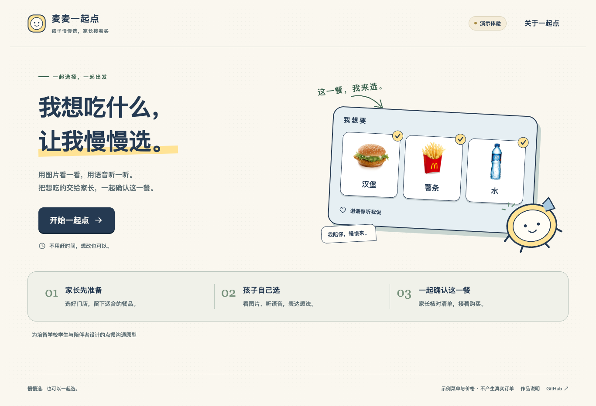
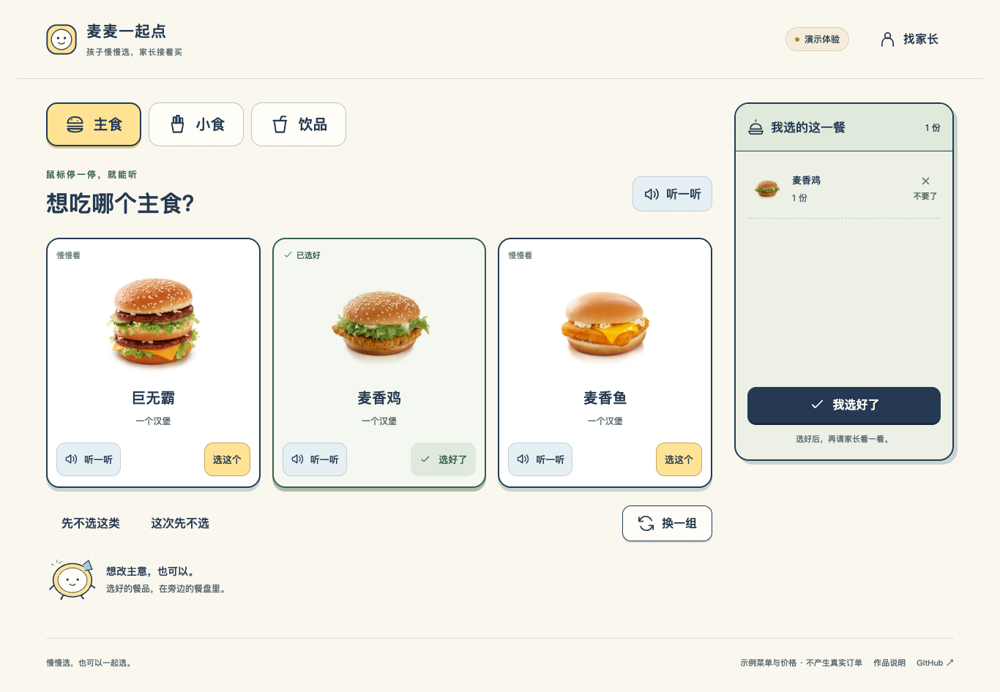
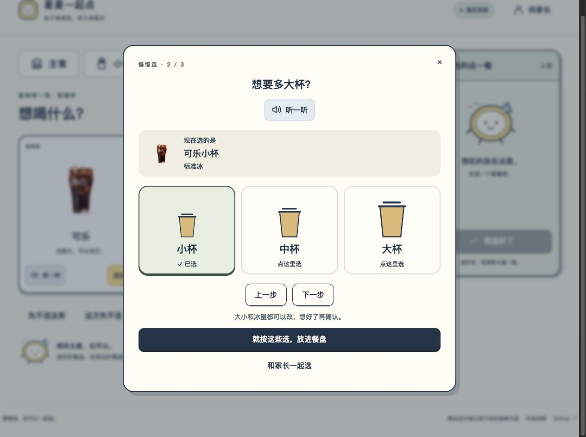

# 麦麦一起点

**孩子慢慢选，家长接着买。**

一个面向培智学校学生和陪伴者的点餐沟通原型：学生用少量餐品图卡和短语音表达想吃什么，家长接手核对清单、门店和金额，再通过麦当劳官方渠道购买。

[在线体验](https://littlebordercollie.github.io/mcd-together-order/) · [演示视频](docs/demo.mp4) · [MCP 接入说明](MCP_INTEGRATION.md) · [配套技能](skills/mcd-together-order/SKILL.md) · [验证记录](docs/VALIDATION.md) · [官方报名](https://github.com/M-China/mcd-developer-innovation-challenge/issues/904)



## 为什么需要它

对一些需要更多认知和沟通支持的学生，复杂菜单、密集文字、套餐选项和催促可能让表达选择变得困难。这个原型尝试把“我想吃什么”与“如何核对并完成购买”分成两个连续环节。

- **学生选择**：每组三张餐品图卡，鼠标停在图卡或“听一听”上即可听读，手机点按播放；可以重复听、改主意、求助，也可以这次什么都不选。
- **表达具体偏好**：选择饮料后，再用图示和语音选择普通／无糖、杯型和冰量；可以慢慢选，也可以请家长一起确认。
- **家长接手**：保留第一次交接时的选择，标明后续调整及操作者；不用重新猜孩子指的是哪一种餐品。
- **连接真实餐品**：本机服务通过官方 MCP 获取门店、单品详情和价格，让图片选择对应到官方餐品编码。

这次探索来自特殊教育交互项目的设计经验。当前没有开展本原型的学生试用，尚不能证明学生能独立完成，也不声称已经测得家长减负效果。

## 体验流程

1. 家长先准备今天可选的餐品，收起不合适的选项。
2. 学生看图片、听名称，选主食、小食和饮品；每一类都可以跳过。
3. 通过图片清单回看：“这些，就是我想要的。”
4. 将设备交给家长，核对餐品、大小、冰量和份数；修改后重新核价并确认。
5. 公开演示以沟通完成结束。本机真实连接经实测和开启下单后，才进入官方订单与付款流程。



饮料规格逐步展开：先选普通或无糖，再选杯型与冰量。图示可以悬停听读，选完后再确认，也可以请家长一起选。



## 当前交付状态

| 能力 | 状态 |
| --- | --- |
| 家长准备、学生选餐、语音、撤销、回顾、交接 | 已实现并通过浏览器检查 |
| 手机固定餐盘、刷新恢复、什么都不选的出口 | 已实现并通过浏览器检查 |
| 普通／无糖可乐、杯型、饮料冰量 | 已按真实选项接入；中杯无糖去冰核价 ¥10，大杯无糖少冰核价 ¥12；本轮未创建订单，见 [规格验证](docs/options-validation.json) |
| 公开演示菜单与价格 | 明确标为示例，不创建真实订单 |
| 官方 MCP 连接、工具参数校验、菜单与报价适配 | 已用真实 Token 验证门店、菜单、详情和核价；见 [真实联调记录](docs/live-validation.json) |
| 创建订单、支付链接和订单查询 | 已创建 1 笔经本人确认的 ¥12 外带订单，取得官方付款链接，并查询到“待支付”；见 [试单记录](docs/trial-order-validation.json) |
| 下单超时、断网后的订单恢复 | 家长核对后恢复已有订单；通过模拟接口与浏览器测试，真实历史接口待验证 |
| 真实付款、取餐 | 本人选择暂不付款；未执行付款或取餐 |
| WorkBuddy 使用 | 已实际按项目技能阅读、审查并产出报告，见 [workbuddy.md](workbuddy.md) |

真实只读调用证据见 [MCP 记录](docs/live-mcp-evidence.json)与[页面联调记录](docs/live-validation.json)。后续真实试单与已知订单找回见 [试单记录](docs/trial-order-validation.json)；付款、取餐及订单号未知时的异常恢复仍待真实验证。

## 本地运行

需要 Node.js 22.9 或更新版本。

```sh
npm ci
npm start
```

打开终端显示的 `http://127.0.0.1:3741`。未配置 Token 时即可体验演示。

```sh
npm test
npm run test:browser
npm run build
```

浏览器检查使用本机 Chrome；开始前先运行 `npm start`。`npm run build` 输出纯静态演示到 `dist/`，可部署到 GitHub Pages，不包含本机配置和服务端文件。

真实连接见 [MCP_INTEGRATION.md](MCP_INTEGRATION.md)。不要将 Token 填进在线演示、提交 Git 或粘贴到聊天。配置示例使用环境变量占位符；不同 MCP 客户端是否展开占位符，请按其文档设置。

## 交互约定

- 没有正确答案、积分、倒计时或强制下一题。
- 点击图片或“选这个”才加入清单；听语音、鼠标停留不代表选择。
- 已选餐品重复点选保持一份。数量由家长在核对页单独调整。
- 已选内容保存在当前浏览器，可以刷新后继续；清理浏览器数据会清除它。
- 网页常用提示、演示餐品、选择反馈与清单朗读统一使用本地 MiniMax 录音。悬停约 450 毫秒开始播放，快速划过不触发；键盘聚焦也可听读。部分浏览器首次需点一下“听一听”允许声音。
- 缺少录音或播放失败时保留文字、图片并提示，不自动切换成系统音色。已为实测取得的 17 个单品补充录音，按官方编码与完整名称双重匹配；菜单新增或规格改名后需补录，不能沿用不匹配的语音。
- 不从图片推断甜度、辣度、过敏原或适食量；不将学生的探索性操作解释成诊断或能力评价。
- 家长勾选是防误触交互，不是监护人身份认证。首版适用于同设备陪伴场景。

## 首版范围

同设备交接、到店自取、单品。暂不做套餐组合、外送地址、跨设备同步、学生档案、学校后台、自动领券或营养建议。

## 素材与来源

- 界面、交互代码与餐盘伙伴形象为本项目制作；学校内部代码、图像、音频和学生资料未复制进公开仓库。
- 演示餐品图来自[麦当劳官网产品媒体页](https://www.mcdonalds.com.cn/media/product)，为官网历史媒体图，不代表当前门店供应。原链接和文件哈希见 [food-sources.json](docs/food-sources.json)。餐品商标及图片权利归原权利人，不属于代码许可证。
- 99 条网页语音和 7 段视频旁白通过 [MiniMax 同步语音合成](https://platform.minimax.cn/docs/api-reference/speech-t2a-http) 实际生成，沿用既有学校案例的 `speech-2.8-hd` / `Chinese_sweet_girl_nv1`，语速 `1`。文案、参数、文件哈希及生成时间见 [audio-sources.json](docs/audio-sources.json)。录音随网页加载，访客悬停不会调用付费接口。
- 官方 MCP 文档：[开放平台](https://open.mcd.cn/mcp/doc)、[接入仓库](https://github.com/M-China/mcd-mcp-server)。
- [官方参赛声明](CONTEST_DECLARATION.md) 按官方文件原文保存。

本作品为独立参赛原型，非麦当劳官方产品。实时餐品、价格、供应与订单结果以官方渠道为准。
